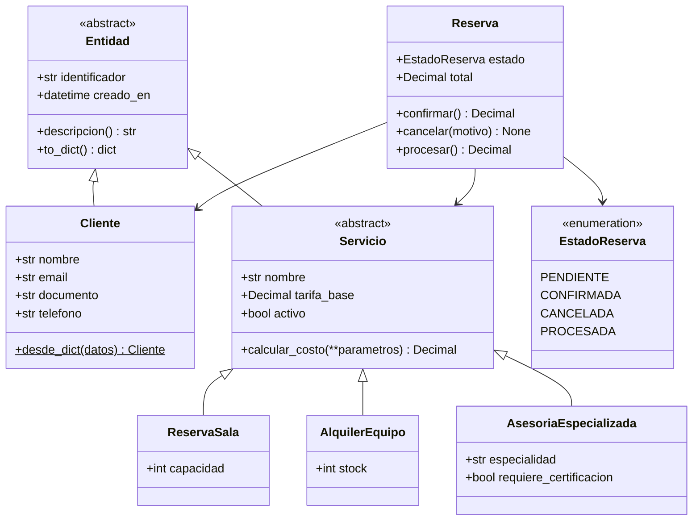

# Sistema de Reservas y Servicios (Python POO)

Sistema académico de reservas de **salas**, **alquiler de equipos** y **asesorías
especializadas**, desarrollado con Programación Orientada a Objetos en Python, validaciones
defensivas, excepciones personalizadas, simulación de escenarios válidos e inválidos y
trazabilidad completa mediante archivo de logs.

El proyecto se desarrolla siguiendo prácticas alineadas a **ISO 9001** (gestión de la
calidad), **ISO/IEC 9126** (calidad del producto de software) e **ISO/IEC 12207** (procesos
del ciclo de vida del software). El detalle de la trazabilidad está en
[docs/calidad-iso.md](docs/calidad-iso.md).

---

## 1. Funcionalidades

- Clase abstracta `Entidad` con identidad y contrato común (`descripcion`, `to_dict`).
- `Cliente` con encapsulación estricta y validación de nombre, correo, documento y teléfono.
- Clase abstracta `Servicio` con tres implementaciones polimórficas:
  - `ReservaSala`: capacidad máxima y recargo del 10 % por ocupación superior al 80 %.
  - `AlquilerEquipo`: control de stock y descuento del 5 % desde 3 unidades.
  - `AsesoriaEspecializada`: exigencia de certificación y recargo del 15 % en sesiones de 4 h o más.
- `Reserva` con máquina de estados `PENDIENTE → CONFIRMADA → PROCESADA`, cancelación
  controlada y auditoría interna de cada evento.
- Excepciones personalizadas jerárquicas con códigos `SR-xxx`, mensajes de detalle y
  encadenamiento de causas (`raise ... from ...`).
- 18 escenarios de simulación (7 válidos y 11 inválidos) y 49 pruebas automatizadas.
- Logging a archivo rotativo con marca de tiempo, nivel, módulo y mensaje.

## 2. Arquitectura



Jerarquía de excepciones: `SistemaReservasError` → `DatosInvalidosError`
(`ClienteInvalidoError`, `ServicioInvalidoError`, `ReservaInvalidaError`),
`OperacionNoPermitidaError` (`TransicionEstadoError`), `ServicioNoDisponibleError`
(`CapacidadExcedidaError`, `StockInsuficienteError`) y `PagoRechazadoError`.

## 3. Estructura del repositorio

```
sistema-reservas-poo/
├── main.py                        # Punto de entrada de las simulaciones
├── pyproject.toml                 # Metadatos, empaquetado y reglas de estilo
├── sistema_reservas/
│   ├── __init__.py
│   ├── excepciones.py             # Jerarquía de excepciones personalizadas
│   ├── entidad.py                 # Clase abstracta Entidad
│   ├── cliente.py                 # Cliente con validaciones y encapsulación
│   ├── servicio.py                # Servicio abstracto + 3 implementaciones
│   ├── reserva.py                 # Reserva y máquina de estados
│   ├── logger_config.py           # Logging rotativo a archivo
│   ├── simulaciones.py            # 18 escenarios válidos e inválidos
│   └── __main__.py
├── tests/
│   ├── test_cliente.py            # 11 pruebas
│   ├── test_servicios.py          # 15 pruebas
│   ├── test_reserva.py            # 15 pruebas
│   └── test_simulaciones.py       # 5 pruebas de integración
├── docs/
│   └── calidad-iso.md             # Trazabilidad ISO 9001 / 9126 / 12207
└── logs/
    └── sistema_reservas.log       # Evidencia de ejecución (generado)
```

## 4. Requisitos y ejecución

- Python 3.10 o superior (probado con Python 3.14).
- Sin dependencias externas: solo biblioteca estándar.

```bash
# Ejecutar las simulaciones (genera/actualiza logs/sistema_reservas.log)
py main.py

# Alternativa como módulo
py -m sistema_reservas

# Ejecutar la suite de pruebas
py -m unittest discover -s tests -v
```

En sistemas Unix, reemplace `py` por `python3`.

## 5. Escenarios de simulación

| #  | Escenario                                          | Tipo     | Resultado esperado                                      |
|----|----------------------------------------------------|----------|---------------------------------------------------------|
| 01 | Flujo completo de reserva de sala                  | válida   | Total S/ 360.00 y estado `PROCESADA`                    |
| 02 | Cliente con correo inválido                        | inválida | `ClienteInvalidoError` (SR-101)                         |
| 03 | Asistentes por encima de la capacidad              | inválida | `CapacidadExcedidaError` (SR-301), estado `PENDIENTE`   |
| 04 | Alquiler de equipo sin stock suficiente            | inválida | `StockInsuficienteError` (SR-302)                       |
| 05 | Alquiler de equipo con descuento por volumen       | válida   | Total S/ 513.00 (5 % de descuento)                      |
| 06 | Asesoría con certificación y recargo               | válida   | Total S/ 920.00 (15 % de recargo)                       |
| 07 | Asesoría sin la certificación exigida              | inválida | `ServicioNoDisponibleError` (SR-300)                    |
| 08 | Cancelación de una reserva procesada               | inválida | `TransicionEstadoError` (SR-201)                        |
| 09 | Confirmación de una reserva cancelada              | inválida | `TransicionEstadoError` (SR-201)                        |
| 10 | Cancelación con motivo demasiado corto             | inválida | `ReservaInvalidaError` (SR-103)                         |
| 11 | Cancelación válida de una reserva confirmada       | válida   | Estado `CANCELADA`                                      |
| 12 | Pago rechazado por superar el límite               | inválida | `PagoRechazadoError` (SR-400), estado `CONFIRMADA`      |
| 13 | Cálculo polimórfico de varios servicios            | válida   | Total S/ 1310.00 con tres tipos de servicio             |
| 14 | Excepción encadenada por datos incompletos         | inválida | Cadena `KeyError → ReservaInvalidaError`                |
| 15 | Liberación de recursos con `try/finally`           | válida   | Archivo temporal eliminado en `finally`                 |
| 16 | Actualización encapsulada de contacto              | válida   | Correo y teléfono normalizados                          |
| 17 | Reserva con fecha en el pasado                     | inválida | `ReservaInvalidaError` (SR-103)                         |
| 18 | Reserva sobre un servicio desactivado              | inválida | `ServicioNoDisponibleError` (SR-300)                    |

Los escenarios ejercitan `try/except`, `try/except/else`, `try/finally` y el encadenamiento
de excepciones. La salida resumida indica `OK` cuando el sistema se comporta como se espera.

## 6. Pruebas automatizadas

La suite contiene **49 pruebas** organizadas por módulo:

| Archivo                   | Pruebas | Cobertura funcional                                   |
|---------------------------|---------|-------------------------------------------------------|
| `tests/test_cliente.py`   | 12      | Validaciones, encapsulación, igualdad, encadenamiento |
| `tests/test_servicios.py` | 17      | Costos, recargos, stock, capacidad, polimorfismo      |
| `tests/test_reserva.py`   | 15      | Estados, cancelación, pagos, fechas, auditoría        |
| `tests/test_simulaciones.py` | 5    | Integración de escenarios y archivo de logs           |

Resultado de referencia: `Ran 49 tests ... OK`.

## 7. Archivo de logs

- Ruta: `logs/sistema_reservas.log` (UTF-8).
- Rotación: 1 MB por archivo, 3 respaldos (`RotatingFileHandler`).
- Formato: `fecha | nivel | módulo | mensaje`.
- La consola muestra solo advertencias y errores; el archivo conserva el detalle completo.
- El archivo incluido en el repositorio es evidencia de la ejecución de los 18 escenarios.

## 8. Normas ISO aplicadas

| Norma        | Enfoque                                                        | Evidencia principal                                      |
|--------------|----------------------------------------------------------------|----------------------------------------------------------|
| ISO 9001     | Gestión de la calidad, trazabilidad y mejora continua          | Historia de issues/ramas/PRs, logs, pruebas, revisión     |
| ISO/IEC 9126 | Calidad del producto: funcionalidad, fiabilidad, mantenibilidad | Validaciones, excepciones, POO, pruebas, modularidad     |
| ISO/IEC 12207| Ciclo de vida: requisitos, diseño, construcción, verificación  | README, diagrama UML, código, suite de pruebas, despliegue |

La matriz completa de trazabilidad requisito → módulo → prueba se encuentra en
[docs/calidad-iso.md](docs/calidad-iso.md).

## 9. Flujo de trabajo en GitHub

Cada módulo se desarrolló con el siguiente flujo, visible en el historial del repositorio:

| Módulo                  | Rama                              | Issue                                        |
|-------------------------|-----------------------------------|----------------------------------------------|
| Excepciones             | `feature/excepciones`             | Jerarquía de excepciones personalizadas      |
| Entidad                 | `feature/entidad`                 | Clase abstracta de entidades generales       |
| Cliente                 | `feature/cliente`                 | Cliente con validaciones y encapsulación     |
| Servicios               | `feature/servicios`               | Servicio abstracto y tres implementaciones   |
| Reserva                 | `feature/reserva`                 | Reserva con confirmación, cancelación y pago |
| Simulaciones y logging  | `feature/simulaciones-logging`    | Escenarios, logging y archivo de logs        |
| Pruebas y documentación | `feature/pruebas-documentacion`   | Suite de pruebas y documentación ISO         |

Cada rama se integró a `main` mediante un pull request que referencia su issue con
`Closes #N`, conservando commits descriptivos por módulo.

## 10. Autor

Santiago González — proyecto académico de Programación Orientada a Objetos.
